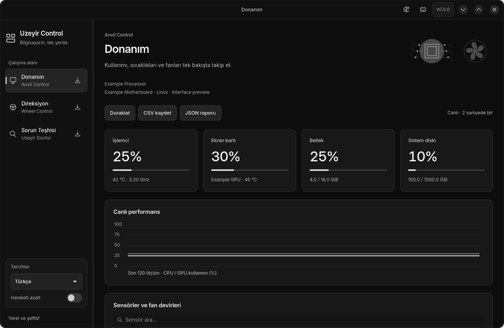
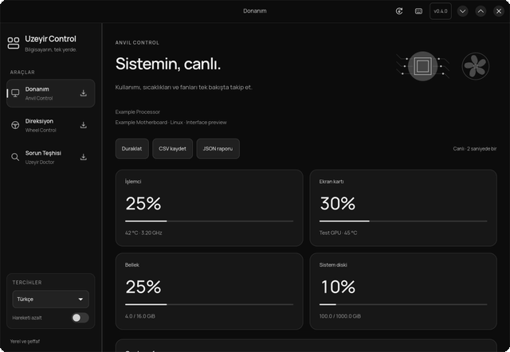
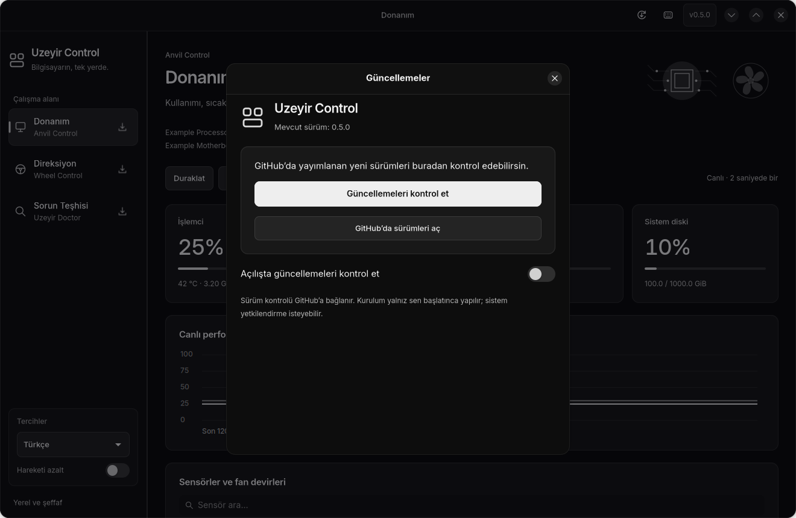

# Uzeyir Control

[](https://github.com/Tubix777/linux-control/actions/workflows/tests.yml)
[](https://github.com/Tubix777/linux-control/releases)
[](COPYING)

**Donanım, direksiyon ve sistem teşhisi. Tek yerel Linux uygulamasında.**

Anvil Control, Wheel Control ve Uzeyir Doctor aynı GTK 4 / libadwaita penceresinde
buluşur. Soldaki düğmelerle bölümler arasında geçiş yap; kullanımı ve sıcaklıkları
izle, direksiyonunu ayarla veya sistemindeki bir sorunun nedenini incele.

[İndir ve kur](https://github.com/Tubix777/linux-control/releases/latest) · [0.4.0 sürüm notları](docs/release-notes.md) ·
[Kurulum rehberi](docs/install.md) · [Sorun bildir](https://github.com/Tubix777/linux-control/issues)



*Arayüz örneği temsili veriler kullanır. Direksiyon önizlemesi açıkça demo olarak işaretlenir.*

## 0.4.0 ile gelen deneyim

- Kısa mesafeli, yumuşak sayfa geçişleri. Geçiş sırasında başka düğmeye basınca
  hareket görünen kareden devam eder; son seçilen bölüm hemen açılır.
- Bölümler arasında kayan sol menü göstergesi, kademeli kart girişleri,
  düğmelerde fare/basma/odak tepkileri ve açılıp kapanan ayrıntılar.
- Gerçek taramayı izleyen etkinlik sinyali, tamamlanınca kısa vurgu ve sonuçlara
  otomatik kaydırma. Elle kaydırmak otomatik hareketi durdurur.
- Kopyalamada düğme üzerinde onay. Dil/filtre değişiminde açık kanıtlar,
  kaydedilmemiş ayarlar ve klavye odağı korunur.
- Uygulama içinden GitHub sürüm kontrolü, doğrulanmış paket indirme ve kullanıcı tarafından başlatılan güncelleme.
- Türkçe / English seçimi, yerel Manrope yazı tipi ve siyah/gri/beyaz görünüm.
  **Hareketi azalt** ve masaüstünün animasyon tercihi anında uygulanır.



*Hareketli kayıt temsili verilerle uygulamanın gerçek GTK arayüzünden alınmıştır.*

## Özellikler

Donanım başlığında hareketli devre ışıkları ve fan etkinlik görseli vardır. Fan yalnız güncel pozitif RPM okumasında döner; dönüş hızı temsili olup gerçek RPM ölçeği değildir. Pencere/bölüm gizlenince, ölçüm eskiyince veya izleme duraklatılınca animasyon durur.

| Bölüm | İşlevler |
| --- | --- |
| Donanım | CPU/GPU kullanımı ve sıcaklık, RAM ve disk kullanımı, canlı geçmiş grafiği, sensör arama, oturum minimum/maksimum değerleri, CSV/JSON dışa aktarma, isteğe bağlı sıcaklık bildirimi |
| Donanım kontrolleri | Sistemin sunduğu güç profilleri, OpenRGB üzerinden mevcut cihazların renk/mod seçimi, desteklenen anakartlarda mevcut Anvil yardımcısı üzerinden fan eğrisi/tam hız/geri alma |
| Direksiyon | Logitech cihaz keşfi ve hotplug, canlı direksiyon/pedal/tuş verileri, sürücünün sunduğu dönüş açısı ve kuvvet geri bildirimi kontrolleri, oyun profili yükleme/kaydetme/içe ve dışa aktarma |
| Sorun Teşhisi | Disk alanı, başarısız sistem/kullanıcı servisleri, NetworkManager durumu, RPM depo tanımları, NVMe SSD dayanıklılık tahmini, Flatpak kurulumu/çalışma ortamı/klasör erişimi |
| İndirme sayfaları | Modüle özel resmî sürüm bağlantıları, mevcut RPM/DEB/taşınabilir/kaynak paketleri, kopyalanabilir kurulum komutları ve isteğe bağlı sürüm kontrolü |

Kontrol ayarları açık bir **Uygula** eylemiyle gönderilir. Bölüm ve dil değişimi ayarları donanıma uygulamaz. Teşhis taraması sistem ayarlarını değiştirmez, uygulama başlatmaz, ayrıcalık istemez ve günlükleri dışarı göndermez.

İndirme ekranları kayıtlı resmî paket bilgileriyle çevrimdışı açılır. **Güncel sürümü kontrol et** düğmesi yalnız ilgili GitHub deposunun herkese açık sürüm bilgilerini sorgular; arayüzü bekletmez. Ağ hatasında mevcut bağlantılar korunur. **İndir** ve sürüm bağlantıları varsayılan tarayıcıda açılır. Üç bölümün indirme ekranı da ilgili bağımsız uygulamanın resmî deposunu açar. Uzeyir Doctor ayrıca [kendi deposunda](https://github.com/Tubix777/uzeyir-doctor) yayımlanır. Manrope uygulama içinde yüklenir; masaüstünün yazı tipi ayarı değiştirilmez.

## İndir ve kur

**Yeni ad: Uzeyir Control** (eski adı Linux Control). Dil, hareket tercihleri,
profiller ve eski başlatıcı komutu korunur.

| Sistem | GitHub Releases indirmesi |
| --- | --- |
| Ubuntu 24.04/26.04, Zorin 18, Deepin 25, Debian 13 | [DEB indir](https://github.com/Tubix777/linux-control/releases/download/v0.4.0/uzeyir-control_0.4.0-1_all.deb) |
| Güncel Arch Linux | [pacman paketi](https://github.com/Tubix777/linux-control/releases/download/v0.4.0/uzeyir-control-0.4.0-1-any.pkg.tar.zst) · [PKGBUILD ve kaynak](https://github.com/Tubix777/linux-control/releases/download/v0.4.0/uzeyir-control-0.4.0-arch-build.tar.gz) |
| Fedora 44 | [RPM indir](https://github.com/Tubix777/linux-control/releases/download/v0.4.0/uzeyir-control-0.4.0-1.fc44.noarch.rpm) |
| Diğer Linux sistemleri | [Kaynak arşivi](https://github.com/Tubix777/linux-control/releases/download/v0.4.0/uzeyir-control-0.4.0.tar.gz) |

[Tüm dosyalar ve SHA256SUMS](https://github.com/Tubix777/linux-control/releases/tag/v0.4.0) ·
[Dağıtıma göre kurulum, sürüm koşulları ve kaldırma](docs/install.md).
DEB için `sudo apt install ./uzeyir-control_0.4.0-1_all.deb`; Arch ve Fedora
komutları kurulum belgesindedir. Kurulumdan sonra menüden **Uzeyir Control**'ü açın.

Asgari Python ≥ 3.11, GTK ≥ 4.12 ve libadwaita ≥ 1.5 gerekir. Kaynak koddan
çalıştırma setuptools veya pip kurulumu gerektirmez. Uygulamanın kendisini
`sudo` ile çalıştırmayın. Eski dağıtımlarda bağımlılıkları atlayarak kurulum yapmayın.

```bash
./run.sh --page doctor
./run.sh --language en
./run.sh --page wheel --wheel-demo
./run.sh --page hardware --downloads
```

`Ctrl+1`, `Ctrl+2`, `Ctrl+3` bölüm değiştirir; `Ctrl+L` mevcut bölümün indirme sayfasını açar. Başlıktaki klavye düğmesi kısayolları gösterir. Dil ve hareket tercihleri kullanıcı ayarlarında saklanır. Direksiyon profilleri mevcut Wheel Control profil dosyasını kullanır; mevcut uygulamalar ve depolar korunur.

## Uygulama içinden güncelleme



Üst çubuktaki güncelleme düğmesi veya `Ctrl+U` ile açın. **Güncellemeleri kontrol et**
yeni kararlı GitHub sürümünü bulur. Sürüm notlarını okuyup **Güncellemeyi indir**
düğmesine basın; gerçek indirme ilerlemesi görünür ve indirme iptal edilebilir.
Paketin boyutu, GitHub'ın SHA-256 özeti ve `SHA256SUMS` kaydı eşleşmeden kurulum açılmaz.

**Kurulumu başlat**, mevcut PackageKit hizmetini kullanır ve sistemin normal
yetkilendirmesini ister. Hizmet yoksa dağıtımın paket kurucusu açılır; o da yoksa
doğrulanmış dosya için kopyalanabilir kurulum komutu gösterilir. **Kurulumu doğrula**
kurulu paket sürümünü sorgular. Başarı doğrulandıktan sonra **Yeniden başlat** ile
yeni sürüme geçin. İndirme/doğrulama hatası kurulum başlatmaz; kurulum hatası başarı
olarak gösterilmez. Çalışan uygulama kendiliğinden kapatılmaz.

**Açılışta güncellemeleri kontrol et** isteğe bağlıdır ve başlangıçta kapalıdır.
Kontrol yalnız ilgili uygulamanın herkese açık GitHub sürüm bilgilerini alır;
tanı sonuçları gönderilmez. Güncelleme otomatik kurulmaz. Bu özellik kurulduktan
sonra, sonraki sürümler GitHub Releases üzerinden uygulamaya ulaşır.

## Donanım desteğinin sınırları

- GPU telemetrisi sürücüye bağlıdır. Kullanılamayan sensörler açıkça belirtilir.
- Fan yazımı yalnız **ASUS PRIME H610M-K D4**, doğrulanmış **NCT6798 kanal 1/2** ve root sahipli, grup/diğer kullanıcılarca yazılamayan **mevcut Anvil fan yardımcısı** ile açılır. Birleşik RPM yeni ayrıcalıklı yardımcı veya geniş sysfs izni kurmaz. Yardımcı bulunamazsa izleme çalışır, fan kontrolleri kapalı kalır.
- Direksiyon ayarları sürücünün sunduğu ve kullanıcıya yazma izni verdiği özelliklerle sınırlıdır. G29, asıl geliştirme cihazıdır; tanınan diğer modellerin her birinde tüm fiziksel kuvvet geri bildirimi davranışları doğrulanmış değildir. [İzinler](docs/permissions.md) kullanılabilir erişim yollarını açıklar.
- SSD'deki **Tahmini kalan ömür**, NVMe üreticisinin tahmini dayanıklılık kullanımından kalan paydır. Genel sağlık garantisi veya arıza olasılığı değildir. Kritik SMART uyarıları ayrı değerlendirilir. 24 saatten eski veya eksik veri yüzde olarak gösterilmez. SATA SSD için bu sürüm genel bir yüzde türetmez.
- NetworkManager bağlantı bilgisi internet erişimini kanıtlamaz. Depo tanımı kontrolü güncelleme işlemini ya da depo erişilebilirliğini test etmez. Flatpak izin kontrolü bir açılış hatasının nedenini tek başına kanıtlamaz.

## Geliştirme ve yayın

```bash
PYTHONPATH=src python3 -m unittest discover -s tests -v
python3 packaging/build_source.py
python3 packaging/build_rpm.py
python3 packaging/build_deb.py  # dpkg-deb bulunan sistemlerde
python3 packaging/build_arch.py # Arch üzerinde normal kullanıcıyla
```

Arayüz testleri gerçek masaüstü yerine ayrı bir sanal compositor altında çalıştırılmalıdır; [doğrulama belgesi](docs/validation.md) ayrıntıları içerir. GitHub Actions, Fedora 44, Ubuntu 24.04/26.04, Deepin 25 ve güncel Arch ortamlarında testleri ve kurulu uygulamanın açılışını kontrol eder. Sürüm etiketi gönderildiğinde doğrulanan RPM, kaynak RPM, DEB, Arch paketi, PKGBUILD/kaynak paketi ve SHA256SUMS GitHub Releases içine eklenir.

[Uygulama planı](PLAN.md), [yayın notları](docs/release-notes.md), [katkı ve lisanslar](ATTRIBUTION.md).

## Yardım ve katkı

[Sık sorulan sorular / sorun giderme](docs/troubleshooting.md) ·
[Katkı rehberi](docs/contributing.md) ·
[Hata veya özellik bildir](https://github.com/Tubix777/linux-control/issues/new/choose)

## English

Uzeyir Control combines hardware monitoring, racing-wheel controls and local system diagnostics in one native GTK 4 window, with a shared monochrome design, bundled Manrope typography, responsive layouts, smooth navigation, scan-result animations and live Turkish/English switching. Each sidebar module has its own official download page. Package links work from bundled metadata offline; checking for newer releases is an explicit action. Download-page commands can be copied manually. The built-in updater verifies release packages and starts native installation only on explicit user request. Reduce Motion respects accessibility preferences. Device settings require explicit actions; diagnostics remain read-only. Unavailable hardware data is never replaced with invented readings. Physical force-feedback coverage and motherboard fan control remain limited to the support described above.
